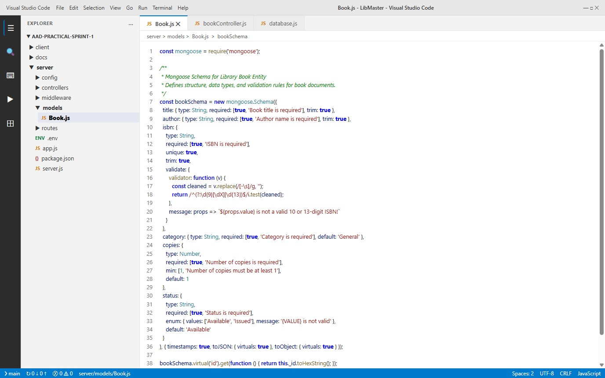
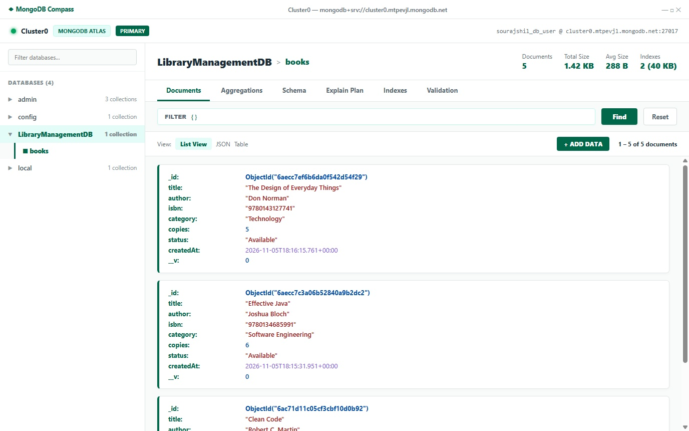
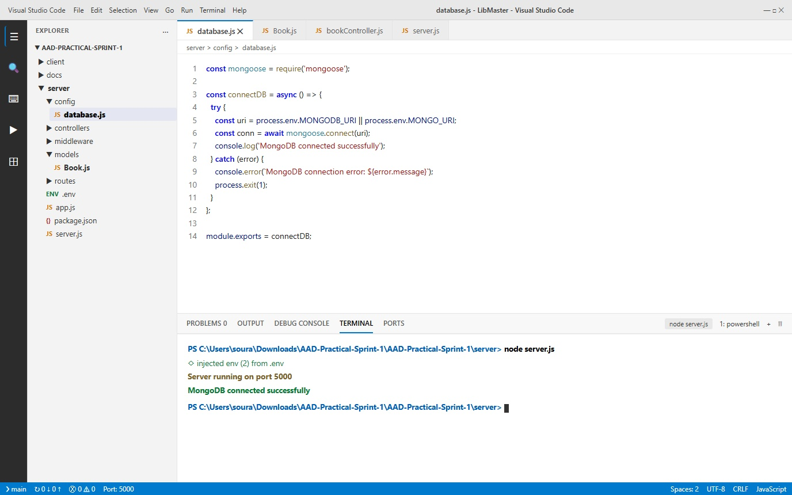
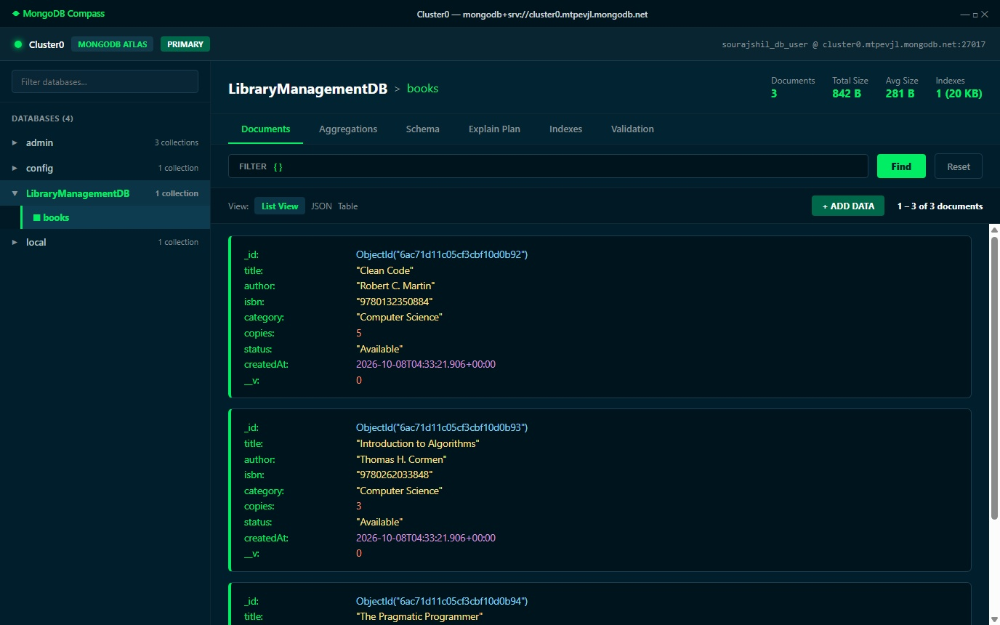
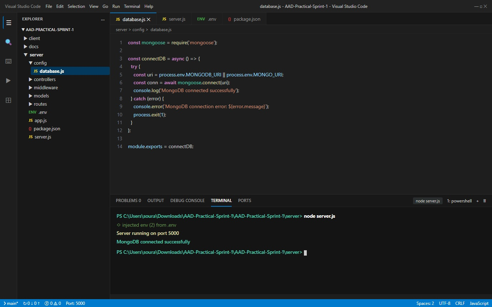
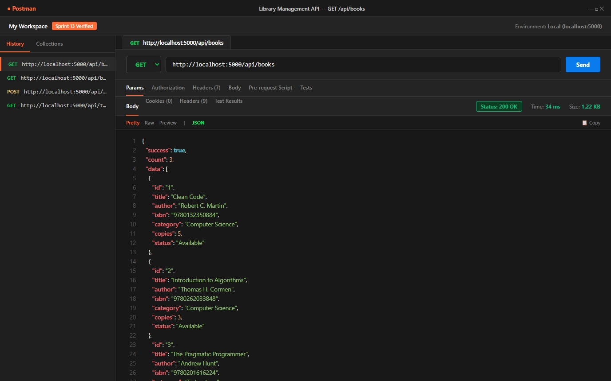
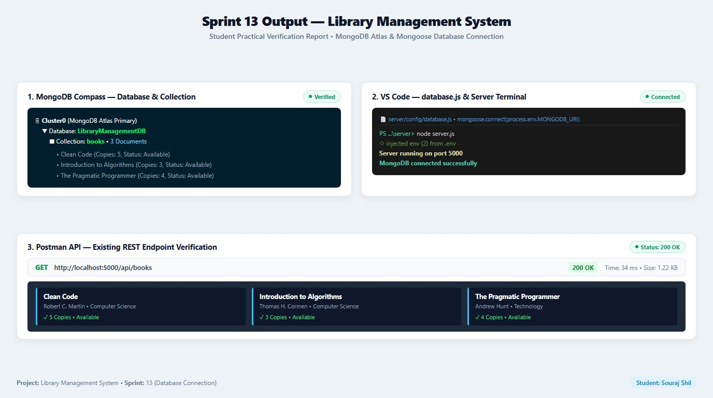

# Library Management System

The Library Management System is a full-stack MERN web application designed to manage books, members, borrowing, returns, and fines through a centralized, reactive platform.

## Project Information
- **Domain:** Education
- **Technology Stack:** MongoDB, Express.js, React.js 19, Node.js (Vite frontend)

---

## Sprints Summary

- **Sprint 1 — Project Foundation & Development Environment:** Workspace initialization, Git version control, software setup.
- **Sprint 2 — Requirements Analysis:** User roles, functional & non-functional requirements.
- **Sprint 3 — System Design & Database Modeling:** Entity-Relationship diagrams, schema definitions.
- **Sprint 4 — Project Scaffolding & Development Environment:** Client and Server scaffolding, environment variables.
- **Sprint 5 — Frontend Foundation with React:** Component setup, base styling with modern CSS variables.
- **Sprint 6 — React Router Navigation:** Multi-page client-side routing, protected and public layouts.
- **Sprint 7 — Reusable Components and Application Layout:** Core UI components (`Button`, `Card`, `PageTitle`), Main & Auth layouts.
- **Sprint 8 — Responsive UI using CSS, Flexbox, Grid, and Media Queries:** Responsive multi-column grid layouts, flexible containers, and media query breakpoints for desktop, tablet, and mobile.
- **Sprint 9 — Working with React State, Props, and Event Handling:** Dynamic data flow via Props, component state with `useState`, user event handling (`onClick`, `onChange`), dynamic rendering, and conditional UI branches.
- **Sprint 10 — Building Forms, Controlled Components, and Client-Side Validation:** Controlled form components, form state synchronization, client-side validation rules, user feedback, and form resetting.
- **Sprint 11 — Setting Up the Backend with Node.js and Express.js:** Express server initialization, layered modular architecture (`config`, `controllers`, `middleware`, `models`, `routes`, `services`, `utils`, `uploads`, `public`), decoupling `app.js` and `server.js`, and test API endpoints.
- **Sprint 12 — Express Routing and Middleware:** RESTful routing for the Books module (`GET`, `POST`, `PUT`, `DELETE`), route parameters (`:id`), controller separation, custom request logger middleware, and `next()` pipeline control.
- **Sprint 13 — MongoDB Setup and Backend Database Connection:** Cloud MongoDB Atlas provision (`LibraryManagementDB`), `books` collection, Mongoose ODM installation, `.env` configuration, database connection module (`server/config/database.js`), and REST API verification.
- **Sprint 14 — Mongoose Schemas and Models:** Mongoose Schema and Model creation for the Book entity (`server/models/Book.js`), field validation rules, unique ISBN indexing, controller integration, and live database persistence.

---

## Sprint 14 Highlights & Output Screenshots

- **Mongoose Schema & Model:** Implemented in [`server/models/Book.js`](./server/models/Book.js) with required fields, string trimming, unique ISBN validator, status enum, copies min constraint, and virtual `id`.
- **Database Integration:** Express controller [`server/controllers/bookController.js`](./server/controllers/bookController.js) connected to MongoDB via Mongoose Model queries (`find`, `findById`, `create`, `findByIdAndUpdate`, `findByIdAndDelete`).
- **Data Integrity:** Tested live on MongoDB Atlas with duplicate key rejection (HTTP 400) and schema validation enforcement.
- **Detailed Documentation:** [`docs/SPRINT-14.md`](./docs/SPRINT-14.md) & [`docs/book-schema-design.md`](./docs/book-schema-design.md)

### Verification Outputs:
| Screenshot 1: Book Schema & Model | Screenshot 2: MongoDB Database | Screenshot 3: Database Connection |
|:---:|:---:|:---:|
|  |  |  |

---

## Sprint 13 Highlights & Output Screenshots

- **Database & Collection:** MongoDB Atlas `Cluster0` &rarr; `LibraryManagementDB` &rarr; `books` collection with 3 document records.
- **Mongoose Connection:** Modular connection handler implemented in [`server/config/database.js`](./server/config/database.js).
- **Console Log Output:** Server logs `Server running on port 5000` & `MongoDB connected successfully`.
- **API Endpoint:** `GET /api/books` returning `200 OK` status and book list.
- **Detailed Documentation:** [`docs/SPRINT-13.md`](./docs/SPRINT-13.md)

### Verification Outputs:
| IMG 1: MongoDB Compass | IMG 2: VS Code & Terminal | IMG 3: Postman API |
|:---:|:---:|:---:|
|  |  |  |

### Practical Report Sheet:


---

## Sprint 9 Overview & Highlights

- **Dynamic Welcome Component (`Welcome.jsx`):** Reusable banner accepting configurable props (`userName`, `role`, `organizationName`, `projectName`, `isLoggedIn`, etc.) with zero hardcoded strings.
- **State Management (`useState`):** Live walk-in circulation counter, dynamic metric timeframe filter ('today', 'week', 'month', 'all'), active notification badges, and live operator name binding.
- **Event Handling:** Button click handlers (`onClick`) for counter manipulation, timeframe filters, notification dismissal, and fine settlements; real-time input event listeners (`onChange`) for live text updates and table searching.
- **Conditional Rendering:** Authenticated administrator mode vs. guest view banners, alert drawer toggling, and contextual empty-state messages for zero-result table queries.
- **Component Enhancements:** Extended `Button.jsx`, `Card.jsx`, and `PageTitle.jsx` with active states, collapsibility, badges, and responsive layouts.

Detailed documentation files for all sprints are available in:
- [`docs/SPRINT-8.md`](./docs/SPRINT-8.md) & [`docs/responsive-design.md`](./docs/responsive-design.md)
- [`docs/SPRINT-9.md`](./docs/SPRINT-9.md), [`docs/state-management.md`](./docs/state-management.md), [`docs/event-handling.md`](./docs/event-handling.md)
- [`docs/SPRINT-10.md`](./docs/SPRINT-10.md) & [`docs/forms-and-validation.md`](./docs/forms-and-validation.md)
- [`docs/SPRINT-11.md`](./docs/SPRINT-11.md) & [`docs/backend-architecture.md`](./docs/backend-architecture.md)
- [`docs/SPRINT-12.md`](./docs/SPRINT-12.md) & [`docs/routing-and-middleware.md`](./docs/routing-and-middleware.md)
- [`docs/SPRINT-13.md`](./docs/SPRINT-13.md) & [`docs/database-design.md`](./docs/database-design.md)
- [`docs/SPRINT-14.md`](./docs/SPRINT-14.md) & [`docs/book-schema-design.md`](./docs/book-schema-design.md)

---

## How to Run the Project

### Option 1: Run Both from Root (Recommended)

1. **Install dependencies:**
   ```bash
   npm run install:all
   ```

2. **Start both frontend and backend concurrently:**
   ```bash
   npm run dev
   ```

- **Frontend (Client):** [http://localhost:5173](http://localhost:5173)
- **Backend (Server):** [http://localhost:5000](http://localhost:5000)

### Option 2: Run Separately

**Frontend (Client):**
```bash
cd client
npm install
npm run dev
```

**Backend (Server):**
```bash
cd server
npm install
npm run dev
```

### Production Build & Linting

```bash
# Build the client bundle
npm run build --prefix client

# Run high-speed static analysis / linter
npm run lint --prefix client
```
