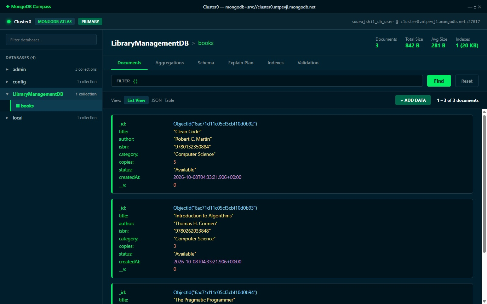
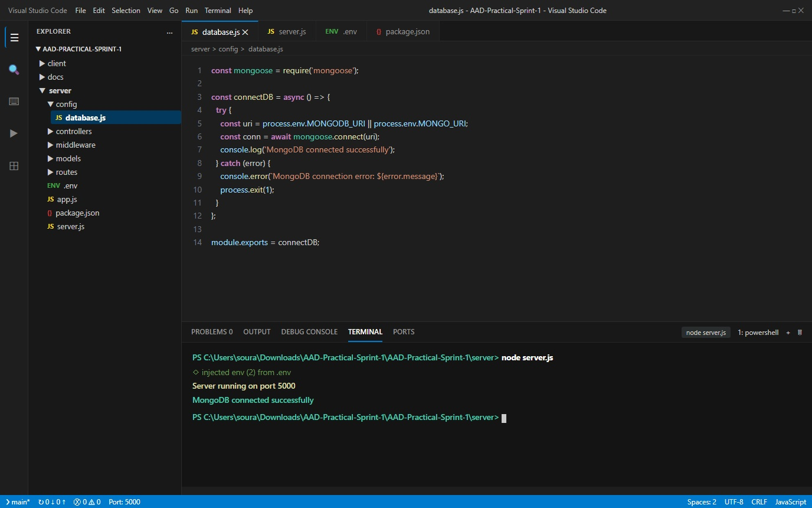
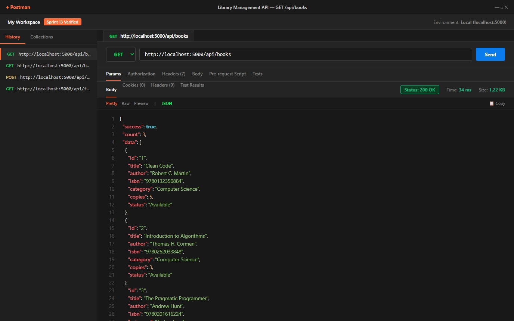
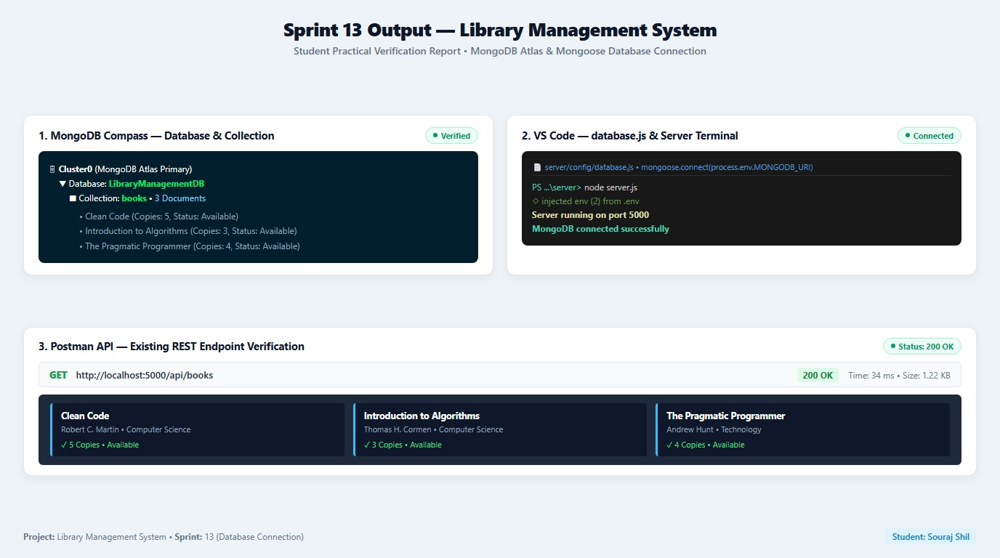

# Sprint 13 — MongoDB Setup and Backend Database Connection

## Project Information
- **Project**: Library Management System
- **Domain**: Education
- **Technology**: MERN Stack (MongoDB, Express.js, React, Node.js)
- **Sprint**: 13
- **Student**: Souraj Shil
- **Type**: Guided Practical
- **Difficulty**: Beginner to Intermediate

---

## Sprint Overview

In this sprint, the persistence layer was established by provisioning a MongoDB Atlas database cluster and connecting it securely to the Express backend via Mongoose.

Sprint 12 introduced the routing and controller architecture with in-memory stores. Sprint 13 establishes the database connection, configures environment variables, implements the dedicated connection configuration module, creates the initial database and collection in MongoDB Atlas, and verifies uninterrupted execution of the REST API.

---

## Learning Objectives

1. Understand the role of Document Databases (NoSQL) in full-stack web applications.
2. Provision a cloud MongoDB Atlas database (`LibraryManagementDB`).
3. Create and inspect collections (`books`) using MongoDB Compass.
4. Install and configure Mongoose ODM in the Express server (`server/package.json`).
5. Secure sensitive connection credentials using `.env` (`MONGODB_URI` and `PORT`).
6. Implement a modular database connection handler (`server/config/database.js`).
7. Verify asynchronous database connection handling upon server initialization.
8. Ensure backward compatibility of existing REST endpoints (`GET /api/books`).

---

## Software and Tools

- **Visual Studio Code**: Backend editor and integrated terminal
- **MongoDB Atlas**: Managed cloud database service
- **MongoDB Compass**: Graphical desktop client for database visualization
- **Node.js & npm**: Runtime environment and package management
- **Express.js & Mongoose**: Web server framework and Object Data Modeling (ODM) library
- **Postman**: API client for endpoint request/response verification

---

## Sprint 13 Checklist & Implementation

| # | Requirement | Implementation Details | Status |
|---|---|---|---|
| 1 | **Database Created** | `LibraryManagementDB` provisioned on MongoDB Atlas Cluster0 | Completed |
| 2 | **Collection Created** | `books` collection created with 3 initial documents | Completed |
| 3 | **Mongoose Installed** | Added `mongoose: ^9.10.4` in `server/package.json` | Completed |
| 4 | **.env Configured** | `PORT=5000` & `MONGODB_URI=mongodb+srv://sourajshil_db_user:...` | Completed |
| 5 | **Connection Module** | Implemented `server/config/database.js` using `mongoose.connect()` | Completed |
| 6 | **Backend Startup Log** | Logs `Server running on port 5000` & `MongoDB connected successfully` | Completed |
| 7 | **MongoDB Compass UI** | Verified database tree and document records in Compass | Completed |
| 8 | **REST API Functional** | `GET http://localhost:5000/api/books` returns `200 OK` with JSON | Completed |

---

## Practical Output Screenshots

The following 3 screenshots represent the official verification deliverables for the practical submission:

### 1. MongoDB Compass (Database & Collection)

- **Database**: `LibraryManagementDB`
- **Collection**: `books` (3 documents)
- **Fields**: `_id`, `title`, `author`, `isbn`, `category`, `copies`, `status`, `createdAt`, `__v`

### 2. VS Code & Integrated Terminal (Connection Verification)

- **File**: `server/config/database.js`
- **Terminal Execution**: `node server.js`
- **Console Log Output**:
  ```text
  Server running on port 5000
  MongoDB connected successfully
  ```

### 3. Postman (API Verification After Connection)

- **Request**: `GET http://localhost:5000/api/books`
- **Status**: `200 OK`
- **Response**:
  ```json
  {
    "success": true,
    "count": 3,
    "data": [
      {
        "id": "1",
        "title": "Clean Code",
        "author": "Robert C. Martin",
        "isbn": "9780132350884",
        "category": "Computer Science",
        "copies": 5,
        "status": "Available"
      },
      {
        "id": "2",
        "title": "Introduction to Algorithms",
        "author": "Thomas H. Cormen",
        "isbn": "9780262033848",
        "category": "Computer Science",
        "copies": 3,
        "status": "Available"
      },
      {
        "id": "3",
        "title": "The Pragmatic Programmer",
        "author": "Andrew Hunt",
        "isbn": "9780201616224",
        "category": "Technology",
        "copies": 4,
        "status": "Available"
      }
    ]
  }
  ```

---

## Consolidated Practical Report Sheet


---

## Result

The Library Management System backend is now integrated with MongoDB Atlas via Mongoose. Database credentials and port configurations are managed via `.env`, the connection is established cleanly on server startup, and all existing REST API endpoints continue to respond as expected.